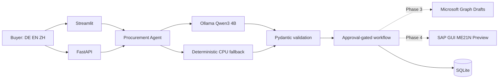

# Local Procurement AI Agent / 本地采购 AI 代理

Local-first procurement assistant for German manufacturing operations. The current milestone is a tested Phase 7 MVP with multilingual purchase-request extraction, structured validation, clarification questions, Streamlit UI, FastAPI API and strict human-approval boundaries. Outlook supports a tested Microsoft Graph client and mock transport; SAP remains a safe preview/mock boundary rather than production automation.

> **Data rule:** this repository contains source code and synthetic demo data only. Never commit real emails, supplier documents, SAP credentials or company procurement data.

## Architecture


## Implemented
- German, English and Chinese UI; German/English/Chinese request detection.
- Local Ollama JSON extraction with deterministic offline fallback.
- Pydantic validation, missing-field questions and no master-data invention.
- FastAPI `/health` and `/api/chat`.
- Streamlit dashboard with explicitly synthetic records.
- RFQ draft model, quotation comparison with deterministic Decimal calculations.
- Email classification for order confirmations, quotations, delays and invoices; PO/material/date extraction and prompt-injection indicators.
- Microsoft Graph mail retrieval, attachment listing, draft creation and approval-gated sending through delegated OAuth2/MSAL.
- Deterministic order-confirmation matching validates PO, supplier sender and material before accepting a match.
- Attachment allowlist, size limits, executable-signature blocking and SHA-256 hashing; production still requires enterprise antivirus scanning.
- Configurable SAP GUI session manager, element-map validation, ME21N navigation, preview population and status-bar reading; real save deliberately disabled.
- Audit JSONL helper, SQLAlchemy/SQLite persistence, supplier/RFQ/quotation/open-PO repositories, delivery events, historical quotation lookup, PDF/Excel adapters and tests.
- Delivery monitoring with the business convention `requested date - confirmed date`: early is positive, late is negative.
- Escalation levels for missing confirmations and overdue deliveries, with external reminder drafts still requiring approval.
- Deterministic dashboard KPIs, supplier confirmation/on-time rates and a three-sheet Excel export.
- Phase 2 API endpoints: `/api/quotations/extract` and `/api/quotations/compare`.
- MOQ-aware quote comparison; non-comparable currencies are rejected unless an exchange-rate layer is explicitly supplied.

## Hardware
Target: Windows 11, NVIDIA RTX 4060 8 GB, Python 3.12+, 16 GB RAM recommended. `qwen3:4b` is the default practical model. `qwen3:8b` may be slower/tighter on 8 GB VRAM depending on quantization and context. CPU fallback remains functional for deterministic extraction.

## Windows installation
1. Install Python 3.12 (enable **Add Python to PATH**), Git, current NVIDIA driver, and Ollama for Windows.
2. In PowerShell:
```powershell
git clone <private-repository-url>
cd ziegler-procurement-agent
py -3.12 -m venv .venv
.\.venv\Scripts\Activate.ps1
python -m pip install --upgrade pip
pip install -r requirements.txt
copy .env.example .env
ollama pull qwen3:4b
ollama run qwen3:4b
```
3. In a second terminal:
```powershell
.\.venv\Scripts\Activate.ps1
uvicorn app.main:app --host 127.0.0.1 --port 8000
```
4. In a third terminal:
```powershell
.\.venv\Scripts\Activate.ps1
streamlit run app/dashboard.py
```
Alternatively run `run.bat`. Keep Ollama and both apps bound locally.

## Ollama
Defaults: `OLLAMA_BASE_URL=http://127.0.0.1:11434`, `OLLAMA_MODEL=qwen3:4b`. For CPU-only operation, turn off **Use local Ollama** in the UI or send `"use_llm": false` to the API. Optional model: `ollama pull qwen3:8b`, then set `OLLAMA_MODEL=qwen3:8b`.

## Environment variables
Copy `.env.example` to `.env`. Microsoft values stay empty until an Entra ID app registration exists. `SAP_DRY_RUN=true` must remain enabled for the MVP.

## Outlook setup (Phase 3 boundary)
Create a Microsoft Entra ID app registration, use delegated OAuth2/MSAL, and grant only the required Microsoft Graph scopes shown in `.env.example`. The implemented gateway retrieves messages, reads attachments and creates drafts through Microsoft Graph. Sending always calls the approval gate. Authentication uses delegated MSAL device code flow and a local git-ignored cache. Register the application as a public client and do not add a client secret. Token persistence must use Windows-protected storage in production; it is not included in Git.

## SAP GUI setup (Phase 4 boundary)
Enable SAP GUI Scripting only with Basis/security approval, install SAP GUI for Windows and pywin32, connect to an already-authorized GUI session, and copy `config/sap_element_ids.example.yaml` to a local ignored configuration. Validate every element ID in the target SAP system. The Phase 4 implementation supports validated preview population and mock execution only; real PO save raises `NotImplementedError` even after approval. Follow [docs/SAP_GUI_SETUP.md](docs/SAP_GUI_SETUP.md).

## Tests
```powershell
pytest
pytest --cov=app --cov=agents --cov=core --cov=integrations
```
Tests use no real Graph account and no real SAP session.

## Phase 7 local knowledge retrieval
Approved local PDF, TXT and CSV documents can be ingested into a separate `data/knowledge.db` database. Documents are SHA-256 deduplicated, split into overlapping chunks and indexed with SQLite FTS5. Retrieval returns citations such as `[purchasing-policy.pdf#chunk-3]`.

```powershell
ollama pull nomic-embed-text
python scripts\ingest_knowledge.py C:\ApprovedDocs\purchasing-policy.pdf
```

Query the grounded context API:
```text
POST /api/knowledge/search
```
The returned instruction explicitly treats retrieved text as untrusted data. If no evidence exists, the deterministic answer fails closed instead of inventing a policy. The optional `OllamaEmbeddingClient` supports `nomic-embed-text`; FTS5 remains the CPU-only default. Never ingest real supplier documents until data classification, retention and access approval are established.

`GET /api/system/config-validation` flags unsafe settings such as `SAP_DRY_RUN=false`, incomplete Graph registration, a non-local Ollama endpoint or `Mail.Send` scope.

## Phase 6 operations
- Application roles: `viewer`, `buyer`, `approver`, `administrator`. These supplement rather than replace SAP and Microsoft Entra authorization.
- Audit JSONL records are SHA-256 hash chained. `verify_audit_chain()` detects edits, deletions in the middle, or reordered records.
- `scripts/run_daily.py` creates a consistent SQLite backup, runs `PRAGMA integrity_check`, writes `latest.json`, and retains 14 backups by default.
- `install_scheduled_task.ps1` registers a Windows daily task at 06:00. Review and run it from an elevated PowerShell.
- `/api/system/health` checks SQLite integrity and reports Ollama, Graph configuration and SAP check status without exposing secrets.
- `.github/workflows/ci.yml` runs the test and compile suite on `windows-latest` with Python 3.12.
- Recovery and incident procedures: [docs/OPERATIONS.md](docs/OPERATIONS.md).

## Security
Local inference is the default. LLM output is validated data, never executable code. Attachments/messages are untrusted. External email and SAP saves require explicit approval. See [docs/SECURITY.md](docs/SECURITY.md).

## Roadmap
- Phase 1: local chat, JSON extraction, validation, demo UI **done**.
- Phase 2: SQLAlchemy persistence, supplier/RFQ repositories, historical quotation lookup, multilingual RFQ drafts, quotation extraction and deterministic comparison **done**.
- Phase 3: MSAL device-code authentication, Graph mail retrieval/draft creation, attachment allowlisting, email classification and deterministic confirmation matching **done**. Real tenant validation and enterprise antivirus integration remain deployment tasks.
- Phase 4: SAP GUI session management, fail-closed element validation, ME21N preview workflow, status-bar validation and mock SAP tests **done**. Site-specific quality-system validation remains a deployment task.
- Phase 5: open-PO persistence, delivery/confirmation monitoring, approval-gated reminder drafts, supplier KPIs, dashboard metrics and Excel reporting **done**.
- Phase 6: role-based authorization, hash-chained audit records, SQLite online backup/retention, Windows Task Scheduler installer, component health checks, operations runbook and Windows CI **done**.
- Phase 7: local procurement knowledge base, safe PDF/TXT/CSV ingestion, SQLite FTS5 retrieval, source citations, prompt-injection-resistant RAG context, optional Ollama embeddings and runtime configuration validation **done**.

## 中文说明
本项目默认在本地运行，核心功能不依赖云端 LLM。当前版本可从德语、英语和中文采购指令中提取结构化字段，识别缺失信息并生成澄清问题。Outlook 与 SAP 仅提供安全接口和模拟实现，尚不会发送真实邮件或保存真实采购订单。Windows 安装步骤与安全要求见上文。

## License
MIT. Company-specific deployment must additionally follow internal IT, data-protection, SAP authorization and works-council requirements.
